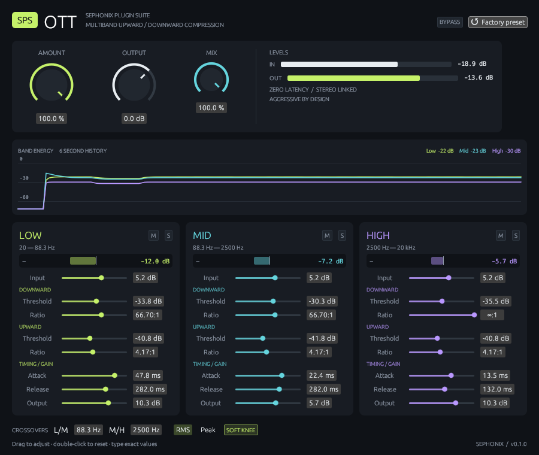

# SPS OTT

**Sephonix Plugin Suite — OTT** is an aggressive three-band upward/downward
compressor written in Rust for Linux DAWs. Native **CLAP, VST3, and LV2** builds
share the same DSP and editor.



- Fourth-order Linkwitz–Riley crossovers with phase-matched band recombination.
- Stereo-linked RMS or peak envelope detection; 6 dB soft knee or hard knee.
- Independent upward/downward thresholds, ratios, timing, and gains per band.
- Amount, final Output gain, phase-aligned dry/wet Mix, bypass, and band mute/solo.
- Live input/output meters, signed band gain meters, and six seconds of band energy history.
- No lookahead, reported latency, FFT, audio-thread allocations, or audio-thread locks.
- Automatable controls, CLAP/VST3 project state, LV2 control-port persistence and factory preset.

This is an OTT-style compressor with the supplied tuning, not a bit-identical
emulation of another plugin. The preset is loud; the output meter shows when
it exceeds 0 dBFS. Output remains floating point without an implicit limiter.

## Build on Linux

Install a current stable Rust toolchain and native X11/OpenGL development packages.
The GUI uses X11, including XWayland in a Wayland session.

```sh
# Debian / Ubuntu
sudo apt install build-essential pkg-config libx11-dev libx11-xcb-dev \
  libxcb1-dev libxcursor-dev libgl1-mesa-dev

# Arch Linux
sudo pacman -S --needed base-devel rust pkgconf libx11 libxcb libxcursor mesa

cargo xtask bundle --release --locked
```

The bundles are written to:

```text
target/bundled/SPS OTT.clap
target/bundled/SPS OTT.vst3/
target/bundled/sps-ott.lv2/
```

Install all three into the current user's standard plugin directories:

```sh
cargo xtask install --release --locked
```

This installs to `~/.clap`, `~/.vst3`, and `~/.lv2`. Restart or rescan plugins in
your DAW and look for **SPS OTT**. Set custom scan paths if your DAW needs them.
The installer replaces existing SPS OTT bundles at those paths.

GitHub Actions builds a Linux bundle archive on every push and pull request;
download it from the workflow's artifacts, extract it, and copy each format
to its matching plugin directory. Building locally also supports your machine's
architecture and system libraries. The CI archive targets x86-64 and Ubuntu 22.04
or a compatible newer Linux distribution.

## Controls

| Control | Behavior |
| --- | --- |
| Amount | 0–100%; scales compression gain and per-band input/output gains. 100% uses the supplied preset in full. 0% has unity magnitude through the crossovers. |
| Output | Final −36 to +18 dB trim after the dry/wet mix. |
| Mix | 0–100%; blends processed audio with phase-aligned dry audio to avoid crossover comb filtering. |
| Bypass | Smoothed switch to the original input; fully settled bypass is sample exact and ignores Output. CLAP/VST3 expose this as host bypass. |
| Crossovers | Low/Mid: 20–1,000 Hz; Mid/High: 1,000–18,000 Hz. Frequencies are limited below Nyquist at low sample rates. |
| Detection | RMS smooths channel power; Peak smooths rectified magnitude. Both use the louder channel to preserve the stereo image. |
| Soft knee | 6 dB transition around each threshold; disable for hard knees. |
| Band controls | Attack, release, thresholds, ratios, input/output gain, Mute and Solo. Multiple solos are supported; Mute takes precedence. |
| Factory preset | Restores every control, including Amount 100%, Mix 100%, Output 0 dB, and bypass off. |

Drag knobs/sliders, double-click to restore their defaults, or edit the numeric
fields for exact values. Ratios use conventional `R:1` notation: the requested
`1:66.7`, `1:inf`, and `1:4.17` are represented as `66.7:1`, `∞:1`, and `4.17:1`.
A downward ratio of 1,000 represents infinity.

Upward gain is capped at +36 dB and fades out between −72 and −90 dBFS detected
level to keep near-silent noise from being boosted indefinitely. If an upward
threshold is moved above its downward threshold, the effective upward threshold
is clamped to the downward threshold; the stored values remain automatable.
The crossover and dry mix rotate phase. Use Bypass when you need the original
signal without phase rotation.

## Factory preset

Crossovers: **88.3 Hz / 2,500 Hz**. Detection: **RMS**. Soft knee: **on**.

| Setting | Low | Mid | High |
| --- | ---: | ---: | ---: |
| Attack | 47.8 ms | 22.4 ms | 13.5 ms |
| Release | 282 ms | 282 ms | 132 ms |
| Downward threshold | −33.8 dB | −30.3 dB | −35.5 dB |
| Downward ratio | 66.7:1 | 66.7:1 | ∞:1 |
| Upward threshold | −40.8 dB | −41.8 dB | −40.8 dB |
| Upward ratio | 4.17:1 | 4.17:1 | 4.17:1 |
| Input gain | +5.20 dB | +5.20 dB | +5.20 dB |
| Output gain | +10.3 dB | +5.7 dB | +10.3 dB |

## Development and validation

```sh
cargo fmt --all --check
cargo clippy --workspace --all-targets --locked -- -D warnings
cargo test --workspace --locked
cargo bench -p sps-dsp --bench throughput

# Native editor preview, with generated activity and no audio device
cargo run -p sps-gui --example preview

# LV2 smoke test, using liblilv-0 (Debian: sudo apt install liblilv-0-0)
python3 scripts/smoke_lv2.py
python3 scripts/smoke_lv2.py --ui --exercise-ui --seconds 10

# Regenerate checked-in LV2 metadata after changing the parameter table
cargo xtask metadata
```

[Validation results and host checks](docs/validation.md) include CPU measurement
conditions. [Architecture](docs/architecture.md) explains the DSP and format
boundaries. Dependency revisions and the lockfile are committed. The vendored
NIH-plug core has two CLAP state fixes documented in
[vendor/nih-plug/PATCHES.md](vendor/nih-plug/PATCHES.md).

Linux is the supported platform. The DSP, shared GUI, and NIH-plug CLAP/VST3
wrapper are portable foundations for Windows and macOS. Those platforms are
not yet tested or distributed; the custom LV2 editor currently supports Linux
X11 only. For future CLAP/VST3 cross-builds use
`cargo xtask bundle sps-ott --release --target=<triple>` with an appropriate toolchain.

## License

SPS OTT is **GPL-3.0-or-later**; see [LICENSE](LICENSE). The vendored NIH-plug core
is ISC-licensed. The pinned `vst3-sys` bindings use GPL-3.0; GUI/backend dependencies
retain their upstream licenses. See [THIRD_PARTY.md](THIRD_PARTY.md).
